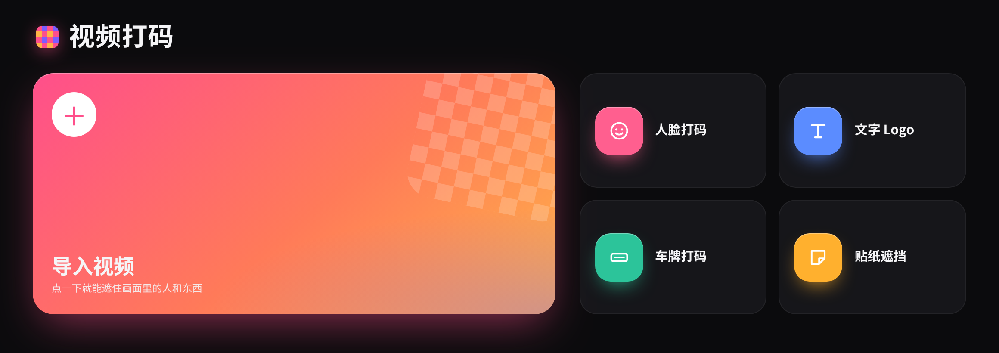

# LocalMask · 本地 AI 视频打码

在自己电脑上给视频打码。点一下画面里的人或东西就能遮住，还会自动跟着它走完整段视频。**视频不会上传到任何服务器。**



## 能做什么

- **人脸打码**：自动找出画面里所有的人，默认全部遮住，想留谁就点一下取消
- **点选**：点一下画面里的任何东西（手机屏幕、杯子、logo…），AI 抠出它的轮廓
- **一句话识别**：写「车牌」「logo」「手机屏幕」，自动找出来
- **框选**：拖一个框遮住任意位置
- **跟随整段**：遮挡会跟着物体移动，走完整条视频
- **五种效果**：马赛克、磨砂、色块、云朵、贴纸（可以上传自己的图片），强度和大小都能调
- **手机视频**：竖拍、HDR、4K 都能直接导入，会自动转成标准格式
- 导出新视频，原声保留，原视频不会被改动

## 安装（Mac）

需要 **Apple 芯片的 Mac**（M1 / M2 / M3 / M4），约 3GB 空间，第一次安装要联网。

1. 按 `⌘ + 空格`，输入「终端」，回车打开
2. 复制下面这一行，粘贴到终端里，按回车：

```bash
curl -fsSL https://raw.githubusercontent.com/lijiatu0717-art/LocalMask/main/install.sh | bash
```

3. 等它装完（大约 5–15 分钟），工作台会自动在浏览器里打开

以后双击**桌面上的「LocalMask」**就能打开。

## 常见问题

**我的视频安全吗？**
工作台只在你自己的电脑上运行（地址是 `127.0.0.1:8765`，只有本机能访问）。视频和打码记录都存在 `~/LocalMask/workbench/data` 里，不会上传到任何地方。

**怎么升级？**
再运行一次上面那行安装命令。已有的视频和打码记录会保留。

**怎么卸载？**
删除个人文件夹里的「LocalMask」文件夹，以及桌面上的快捷方式。

**安装失败了？**
大多是网络问题，再运行一次安装命令会从中断的地方接着装。还是不行，请在本项目的 Issues 里贴上终端截图。

## 重要提醒

- AI 识别可能会漏，尤其是很小、侧着、被挡住的脸。**发布前请完整看一遍导出的视频。**
- 马赛克和磨砂不是加密，非常敏感的内容建议用「色块」完全盖住。
- 请只用来保护隐私，不要用来掩盖违法违规内容。

## 用到的开源项目

| 用途 | 项目 | 许可 |
|---|---|---|
| 点选抠图、视频追踪 | [SAM 2.1](https://huggingface.co/facebook/sam2.1-hiera-tiny)（Meta） | Apache-2.0 |
| 一句话识别 | [Grounding DINO](https://huggingface.co/IDEA-Research/grounding-dino-tiny)（IDEA Research） | Apache-2.0 |
| 人脸检测 / 同一人识别 | [YuNet / SFace](https://github.com/opencv/opencv_zoo)（OpenCV Zoo） | MIT / Apache-2.0 |
| 视频处理 | [FFmpeg](https://ffmpeg.org)（通过 static-ffmpeg 下载）、OpenCV、PyTorch、Transformers | 各自许可 |

模型和 FFmpeg 都是安装时从官方地址下载的，本项目不打包分发。

## 许可

[MIT](LICENSE)

---

## English

**LocalMask** — a local, privacy-first video redaction tool for macOS (Apple silicon). Click a person or object to mask it and track it through the whole video; detect faces automatically or describe what to hide ("license plate", "logo"). Effects: pixelate, frosted blur, solid, cloud, sticker. Everything runs on `127.0.0.1`; videos never leave your machine.

**Install:** open Terminal and run

```bash
curl -fsSL https://raw.githubusercontent.com/lijiatu0717-art/LocalMask/main/install.sh | bash
```

Then double-click "LocalMask" on your Desktop to open it. Run the same command again to update. Always review the exported video — AI detection can miss small or occluded faces.
